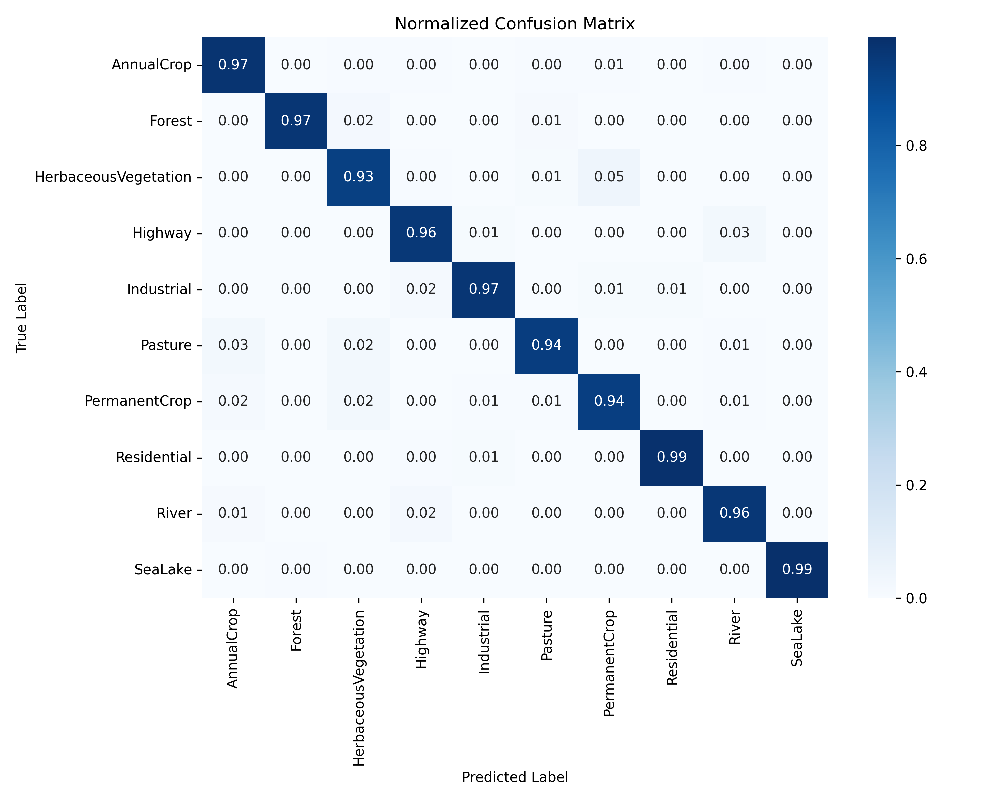

Check out the configuration reference at https://huggingface.co/docs/hub/spaces-config-reference

---

# 🛰️ Land Use and Land Cover Classification App

This project provides an **image classification app** trained to recognize **land use and land cover categories** from satellite images using the **EuroSAT dataset**. The model is built on top of **MobileNetV3** using **transfer learning**, and fine-tuned for high performance on remote sensing imagery.

---

## 🧠 What This Project Does

It classifies uploaded satellite images into one of 10 possible land cover types, such as:

| Class Name         | Emoji     | Description                        |
|--------------------|-----------|------------------------------------|
| **Annual Crop**     | 🌾        | Fields with seasonal crops         |
| **Forest**          | 🌳        | Tree-covered areas                 |
| **Herbaceous Vegetation** | 🌿  | Low-growing green cover           |
| **Highway**         | 🛣️        | Roads and highways                 |
| **Industrial**      | 🏭        | Factories, warehouses, zones       |
| **Pasture**         | 🐄        | Grazing land, open green fields    |
| **Permanent Crop**  | 🌴        | Vineyards, orchards, etc.          |
| **Residential**     | 🏘️        | Houses, towns, settlements         |
| **River**           | 🏞️        | Flowing water bodies               |
| **Sea/Lake**        | 🌊        | Still water bodies (blue areas)    |

---

## 🚀 How to Use the App

This Hugging Face Space allows **interactive image classification**:

### 👉 Steps:

1. **Upload an image** (ideally a satellite-like image).
2. Click **"Submit"**.
3. The app returns the **predicted class label** with confidence score.

No setup is required — it runs directly in your browser using the trained model.

---

## 🧪 Example Use Case

| Input Image | Predicted Class | Description |
|-------------|-----------------|-------------|
|  | Residential | Athen's Center, Greece |
|  | Highway | Autobahn, Germany |
|  | River | Nile River |

---

## 🗂️ Dataset: [EuroSAT (RGB)](https://madm.dfki.de/downloads)

- The model is trained on the **EuroSAT RGB version**, consisting of **27,000+ satellite images** (64×64 pixels).
- The dataset is structured into **10 labeled classes** representing various land cover types from Sentinel-2 satellite imagery.

---

## 🏗️ Model Architecture & Training

- **Base Model:** `MobileNetV3Small` (pretrained on ImageNet, top removed, average pooled)
- **New Layers:**
  - Fully connected (Dense) layer with 256 units and ReLU activation
  - Dropout layer (rate = 0.3) for regularization
  - Final Dense layer with 10 units and softmax activation for classification
- **Optimizer:** Adam with custom learning rate (initially 1e-3, then 1e-5 during fine-tuning)
- **Loss:** Categorical Crossentropy
- **Metrics:** Accuracy
- **Callbacks Used:**
  - EarlyStopping 
  - ReduceLROnPlateau

### 🔁 Training Process

1. **Initial training:** Freeze the base MobileNetV3Small model and train only the new classifier layers for 5 epochs.
2. **Fine-tuning:** Unfreeze last 50 layers of the base model and continue training with a lower learning rate (1e-5) for 10 more epochs.

Final model is exported in `.keras` format and used in a Gradio app.

---

## Evaluation

The dataset (27,000 Sentinel-2 RGB images across 10 classes) was partitioned using a deterministic stratified **70/15/15** split (`random_state=42`): **18,900** training, **4,050** validation, and **4,050** held-out test images. Data augmentation was restricted strictly to the training set; validation was used for `EarlyStopping` and `ReduceLROnPlateau`, and the test set was evaluated once after training.

| Metric | Held-Out Test Set (n = 4,050) |
| :--- | :---: |
| **Top-1 Accuracy** | **96.25%** |
| **Macro-F1** | **0.9612** |
| **Weighted-F1** | **0.9625** |
| **Per-Class F1 Range** | 0.93 – 0.99 |

Most misclassifications occur between visually similar vegetation classes (e.g., *HerbaceousVegetation* and *PermanentCrop*), while *SeaLake* and *Residential* reach 0.99 F1.

---

## 🧰 Tech Stack

- **TensorFlow/Keras**
- **MobileNetV3**
- **EuroSAT RGB dataset**
- **Gradio (for UI)**
- **Hugging Face Spaces**

---

## 📦 Files Included

- `app.py` – Gradio app using the trained model
- `eurosat_classifier.keras` – Saved fine-tuned classification model
- `requirements.txt` – Python dependencies
- `LandCoverApp.ipynb` - Notebook used for the whole process
- `confusion_matrix.png` - Confusion Matrix
---

## 📜 License & Credits

- Dataset: [EuroSAT by Helber et al. (2019)](https://github.com/phelber/eurosat)
- MobileNetV3: Pretrained on ImageNet
- This app is for educational and demonstrative purposes.

---
